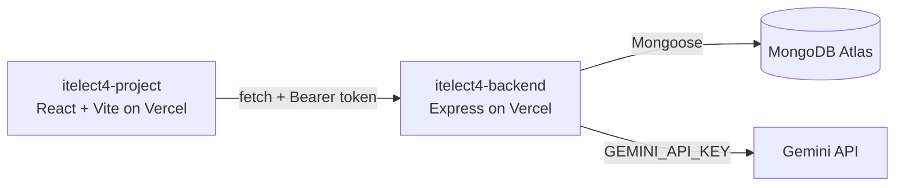

# itelect4-backend

[](https://github.com/djancatibog/itelect4-backend/actions/workflows/ci.yml)

The REST API behind the Campus Lost & Found Tracker: Express 5 in TypeScript, MongoDB Atlas through Mongoose, JWT authentication, and a route that uses Google Gemini to generate lost and found report drafts.

- **Live API:** https://itelect4-backend-iota.vercel.app/api/health
- **Live Frontend:** https://itelect4-project-puce.vercel.app
- **Frontend Repo:** https://github.com/djancatibog/itelect4-project

## Architecture



## How to Install & Run Locally

1. Clone the repository:
   ```bash
   git clone https://github.com/djancatibog/itelect4-backend.git
   cd itelect4-backend
   ```

2. Install dependencies:
   ```bash
   npm install
   ```

3. Configure environment variables in `.env`:
   ```env
   PORT=4000
   MONGODB_URI=your_mongodb_atlas_connection_string
   JWT_SECRET=your_jwt_secret
   CORS_ORIGIN=http://localhost:5173
   GEMINI_API_KEY=your_gemini_api_key
   ```

4. Start the development server:
   ```bash
   npm run dev
   ```

5. Run the tests:
   ```bash
   npm test
   ```

## AI Disclosure
AI tools (Claude / Antigravity) were used to assist in test suite setup, workflow configuration, and code review.